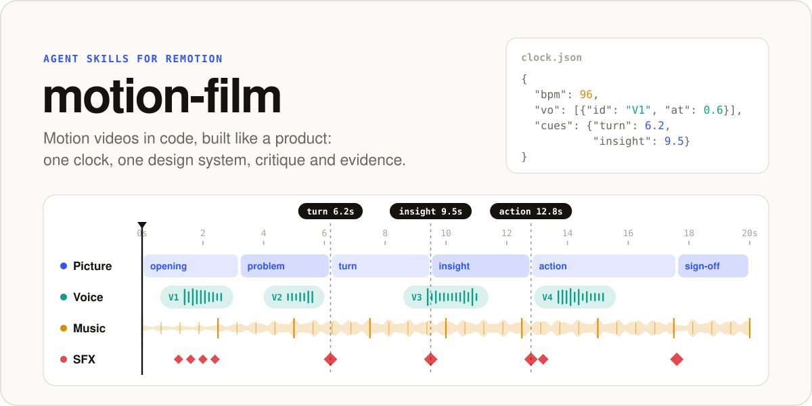
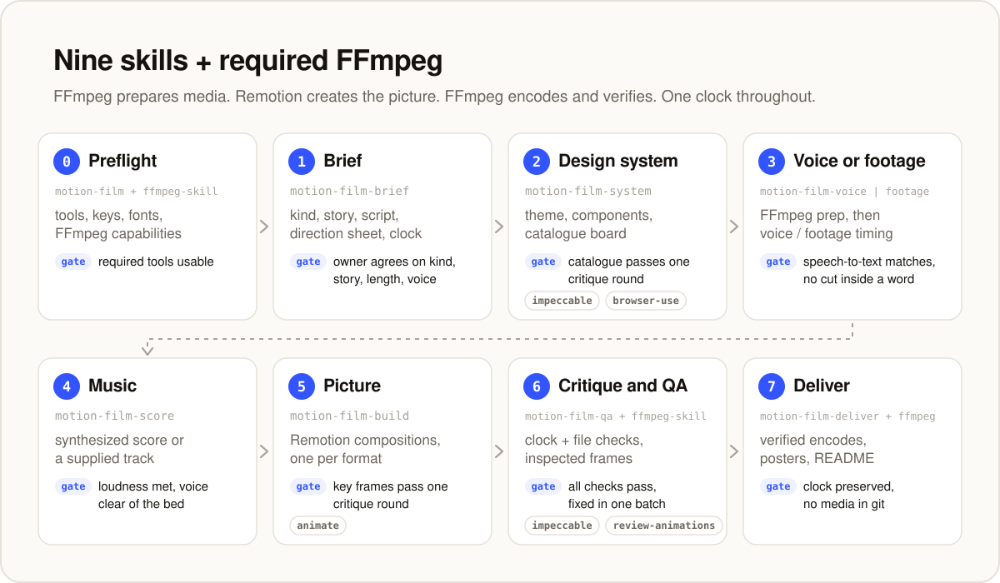
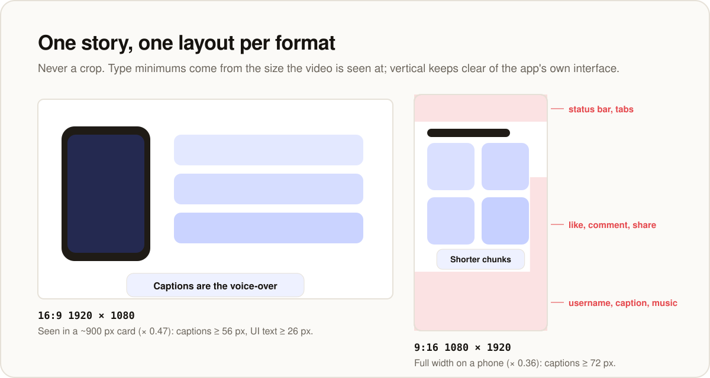
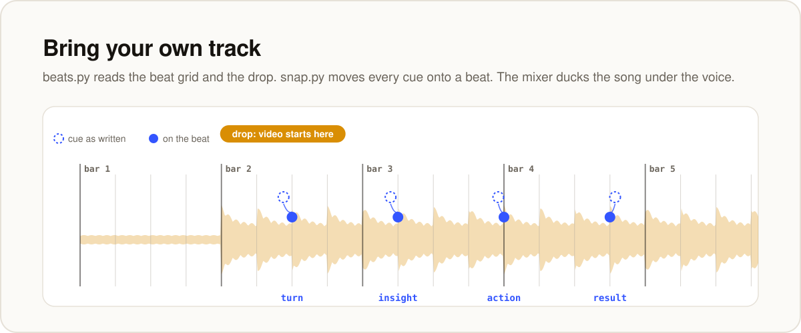
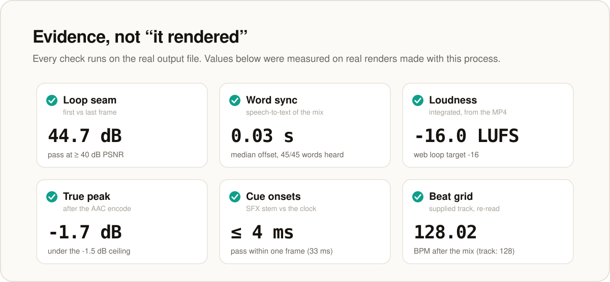

<p align="center">
  <picture>
    <source media="(prefers-color-scheme: dark)" srcset="assets/hero-dark.svg">
    
  </picture>
</p>

<p align="center">
  <a href="LICENSE"></a>
  
  <a href="https://www.remotion.dev"></a>
  
</p>

**motion-film** is a set of agent skills that teach your coding agent to make **consistent, high-craft motion videos in code** for a product or a body of content: landing-page loops, launch films, showreels, animated product demos, vertical cuts for Reels and TikTok, and recurring content series.

The idea is simple: a video is frontend work with a clock. Every frame is a designed screen, so it is built from your design system, critiqued like UI, and checked with evidence. Picture, voice-over, music and sound effects all read **one clock file**, so a spoken word, a sound hit and a motion land on the same frame.

```sh
npx skills@latest add arhen/motion-film --skill '*'
```

<br>

## What you get

<table>
  <tr>
    <td width="33%" valign="top"><b>A process with gates</b><br>Eight phases from brief to delivery. Each has an output and a gate, so nothing ships on "it rendered".</td>
    <td width="33%" valign="top"><b>One clock</b><br><code>clock.json</code> holds every voice slot and named cue. Picture, captions, music, sound effects and QA all read it.</td>
    <td width="33%" valign="top"><b>Your design system, for video</b><br>Tokens imported, not copied. Type minimums for the real playback size, logo rules, rebuilt components, safe zones per format.</td>
  </tr>
  <tr>
    <td valign="top"><b>Voice-over that stays in sync</b><br>Takes with word timestamps, checked line by line with speech-to-text, placed on the clock.</td>
    <td valign="top"><b>Music two ways</b><br>A score synthesized in code that hits every cue, or your own licensed track with the cues snapped onto its beats.</td>
    <td valign="top"><b>Evidence QA</b><br>Frames from the real file, loop seam, word sync, loudness, cue timing, brand and honesty audits, and an embed check.</td>
  </tr>
</table>

## Quick start

**1. Have a Remotion project.** These skills do not create one. Follow Remotion's guide ([remotion.dev/docs](https://www.remotion.dev/docs)), usually `npx create-video@latest`.

**2. Install the skills** (all eight; they work as a suite):

```sh
npx skills@latest add arhen/motion-film --skill '*'          # into this project
npx skills@latest add arhen/motion-film --skill '*' -g       # for your user, all projects
npx skills@latest add arhen/motion-film --skill '*' -a claude-code   # one agent only
```

No Node? Copy the folders by hand: see [Manual install](#manual-install).

**3. Ask your agent for a video.** The entry skill is `motion-film`; it runs the phases in order and asks you only the taste calls.

> Use motion-film to make a 20-second looping explainer for our landing page. Our tokens are in `src/styles/tokens.css` and the brand rules are in `brand/`.

> Make 15-second vertical cuts of the launch film for Reels, one per audience, with captions.

> Lay our licensed track `music/launch.mp3` under the launch film and lock the scene changes to its beats.

> Run a QA pass on `out/launch.mp4`: frames, loop seam, word sync and loudness.

<br>

## For AI agents

> **If you are an AI agent** and a user asked you to install or use this repository, follow these steps exactly. Ask the user before anything that overwrites files, costs money, or is not listed here.

1. **Install all eight skills together.** They reference each other's scripts by relative path, so a single skill on its own is incomplete.
   ```sh
   npx skills@latest add arhen/motion-film --skill '*' -y
   ```
   - Add `-g` to install for the user (all projects) instead of the current project. If the user did not say, ask which they want.
   - Add `-a <agent>` to target one agent, for example `-a claude-code`, `-a codex`, `-a cursor`, `-a opencode`.
2. **If `npx` is unavailable or the command fails**, install by hand (see [Manual install](#manual-install)): clone the repository, copy every `skills/motion-film*` folder into the agent's skills folder, and do not overwrite an existing folder of the same name without asking.
3. **Verify.** There must be eight folders (`motion-film`, `motion-film-brief`, `motion-film-system`, `motion-film-voice`, `motion-film-score`, `motion-film-build`, `motion-film-qa`, `motion-film-deliver`), each with a `SKILL.md` whose `name` matches the folder.
   ```sh
   ls <skills dir> | grep motion-film
   head -3 <skills dir>/motion-film/SKILL.md
   ```
4. **Do not, as part of installing:**
   - create a Remotion project;
   - install companion skills;
   - generate voice-over or call any paid API;
   - commit anything.

   Offer these to the user instead.
5. **Report to the user:**
   - what you installed and where;
   - which [companion skills](#companion-skills-optional) are optional;
   - what they need ([Requirements](#requirements));
   - how to start: "ask for a video; the entry skill is `motion-film`".
6. **When you use the skills:**
   - load `motion-film` first and follow its phases in order;
   - copy scripts and templates into the user's video project before running them;
   - never commit generated media.

<br>

## How it works

<picture>
  <source media="(prefers-color-scheme: dark)" srcset="assets/pipeline-dark.svg">
  
</picture>

| Skill | What it does |
|---|---|
| [`motion-film`](skills/motion-film/SKILL.md) | **Entry point.** The whole process, the quality bar, preflight checks, lessons that cost a re-render. |
| [`motion-film-brief`](skills/motion-film-brief/SKILL.md) | **1. Brief.** One story and one motion language per video, the script, formats, the clock skeleton. |
| [`motion-film-system`](skills/motion-film-system/SKILL.md) | **2. Design system.** Video theme from your tokens, type minimums per format, logo and asset rules, components, a catalogue board. |
| [`motion-film-voice`](skills/motion-film-voice/SKILL.md) | **3. Voice-over.** Audition, takes with word timings, speech-to-text checks, slot fitting. |
| [`motion-film-score`](skills/motion-film-score/SKILL.md) | **4. Music and SFX.** Synthesized score or a supplied track, SFX on cues, ducking, loops, loudness. |
| [`motion-film-build`](skills/motion-film-build/SKILL.md) | **5. Picture.** Remotion patterns, one layout per format, captions, loop seams, motion blur, pitfalls. |
| [`motion-film-qa`](skills/motion-film-qa/SKILL.md) | **6. Critique and QA.** One bounded critique round, then evidence from the real file. |
| [`motion-film-deliver`](skills/motion-film-deliver/SKILL.md) | **7. Deliver.** Masters, web encodes, posters, embed snippet, a README with a summary per video. |

### One clock

Every timing lives in one file. Scenes read cues by name, captions read word timestamps, the mixer places voice and sound effects from the same numbers, and the QA scripts compare the result against it.

```json
{
  "fps": 30, "seconds": 20.0, "bpm": 96, "width": 1920, "height": 1080,
  "vo": [
    {"id": "V1", "at": 0.6},
    {"id": "V3", "alignWord": 2, "at": 9.5},
    {"id": "V4", "alignWord": 0, "beat": 24}
  ],
  "cues": {
    "elementsIn": [1.2, 1.6, 2.0, 2.4],
    "turn": 6.2, "insight": 9.5, "signoff": 17.6,
    "loop": [19.5, 20.0]
  }
}
```

A voice line can start at a time, put a chosen word on a time, or put a word on a beat.

### Formats

<picture>
  <source media="(prefers-color-scheme: dark)" srcset="assets/formats-dark.svg">
  
</picture>

Each format gets its own layout from the same story, clock and components. Type minimums come from the playback size, and vertical cuts stay clear of the buttons and text that Reels, TikTok and Shorts draw over the video. `grid.py --safe` tints those zones on review boards.

### Music

<picture>
  <source media="(prefers-color-scheme: dark)" srcset="assets/music-dark.svg">
  
</picture>

- **Synthesized in code:** the tempo makes the length whole bars, every hit sits on a cue, and no licence is needed.
- **Your own track:**
  - `beats.py` finds the tempo, the beat grid, the bar starts and the drops.
  - `snap.py` moves the cues onto beats and writes the track into the clock.
  - The mixer ducks the song under the voice. A loop cross-fades into the track's own lead-in, so the seam is inaudible.

### Evidence

<picture>
  <source media="(prefers-color-scheme: dark)" srcset="assets/evidence-dark.svg">
  
</picture>

Critique is bounded: render the boards, critique once, fix everything in one batch, confirm once, stop. Then every check runs on the real MP4 or WebM, because stills miss stacking bugs, blank frames and loop glitches. Whatever cannot be measured, such as how the music feels, is reported as needing human ears.

<br>

## Requirements

- A **Remotion** project ([setup guide](https://www.remotion.dev/docs)).
- **Node 20+**, **Python 3** with numpy, scipy and Pillow, and **ffmpeg** with libx264, libvpx-vp9, libopus and aac.
- For voice-over: an **ElevenLabs** account (text to speech with timestamps, speech to text). Optional; videos can be music-only.
- For capturing your product and checking embeds: **Chrome** and a browser automation tool.

Tested on macOS. Linux should work; on Windows, use WSL.

## Licences and costs

- **Remotion** has its own licence: free for individuals, non-profits and companies of up to 3 people; larger companies need a company licence. Check [remotion.dev/license](https://www.remotion.dev/license).
- **ElevenLabs** (or any voice provider) charges per character. The voice skill asks before spending.
- **Fonts** must be licensed for video. Brand fonts usually are; check before copying them into a project.
- **Music:** a synthesized score needs no licence. A supplied track needs a written licence that covers the use (web, ads, social).
- **Sample data:** people, businesses and numbers on screen are either real and approved, or fictional and labelled as sample data.

## Companion skills (optional)

The suite leans on frontend skills instead of repeating them. Each phase says what to do without them.

| Skill | From | Used for |
|---|---|---|
| `impeccable` | [pbakaus/impeccable](https://github.com/pbakaus/impeccable) | Project context, design critique, typography, extracting tokens and components |
| `review-animations`, `animate`, `animation-vocabulary`, `emil-design-eng` | [emilkowalski/skills](https://github.com/emilkowalski/skills) | Motion critique, building one animation right, naming effects, polish |
| `browser-use` | [browser-use/browser-harness](https://github.com/browser-use/browser-harness) | Capturing live product screens, checking the video in its page |

```sh
npx impeccable install
npx skills@latest add emilkowalski/skills
```

For browser-harness, follow its [install guide](https://github.com/browser-use/browser-harness/blob/main/install.md).

## Manual install

```sh
git clone --depth 1 https://github.com/arhen/motion-film /tmp/motion-film
cp -R /tmp/motion-film/skills/motion-film* <skills dir>/
```

| Agent | For your user | For one project |
|---|---|---|
| Claude Code | `~/.claude/skills/` | `.claude/skills/` |
| Codex, Pi, Cline, Warp, Zed | `~/.agents/skills/` | `.agents/skills/` |
| OpenCode | `~/.config/opencode/skills/` | `.agents/skills/` |
| Cursor | `~/.cursor/skills/` | `.agents/skills/` |
| Gemini CLI | `~/.gemini/skills/` | `.agents/skills/` |
| GitHub Copilot | `~/.copilot/skills/` | `.agents/skills/` |

To update, run the install again, or `npx skills update`.

## What is inside

```
skills/
  motion-film/            entry point: phases, gates, preflight, lessons
  motion-film-brief/      MOTION-LANGUAGES.md, templates/BRIEF.md, templates/clock.json
  motion-film-system/     templates/theme.ts, Catalog.tsx, VIDEO-SYSTEM.md
  motion-film-voice/      scripts/vo.mjs, stt.mjs, slotfit.py, voice-stats.py
  motion-film-score/      scripts/synth.py, mix_template.py, beats.py, snap.py, onsets.py
  motion-film-build/      PATTERNS.md, templates/anim.ts, clock.ts, Subtitles.tsx, FilmShell.tsx …
  motion-film-qa/         scripts/stills.mjs, frames.sh, grid.py, seam.sh, sync.py, probe.sh, brand-audit.sh
  motion-film-deliver/    scripts/encode-web.sh, templates/README-films.md
assets/                   README diagrams (python3 assets/build.py rebuilds them)
```

Copy scripts and templates into your video project before running them; Node resolves packages from the script's own folder.

## Contributing

New motion languages, patterns, voice providers and formats are welcome. A contribution should:

- pass the same gates the skills ask of a video;
- include the evidence: boards, frames, numbers;
- stay generic, with no product names, data or paths from one project.

## Licence

[MIT](LICENSE)
